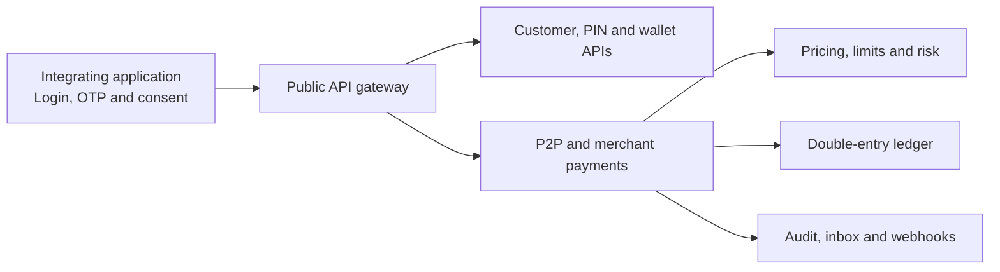

<p align="center">
  
</p>

# BOODOO — Core Mobile Money APIs

BOODOO is an open-source backend platform for integrating mobile money capabilities into other applications: customer onboarding, transaction PINs, digital wallets, transfers, merchant payments and double-entry accounting.

Integrating applications own user login, consent, OTP delivery and OTP verification. BOODOO exposes authenticated APIs and manages the financial workflows behind them.

## Project status

**Version 0.1 — API pilot under development.** This README describes the combined pilot feature set. Pilot deployment and full-stack commands require the domain feature PRs and the release operations PR to be merged.

The initial pilot validation passed **247 service tests across 13 services**, plus a real-service scenario covering lost ledger acknowledgements, concurrent spending, signed webhook delivery and restoration of all **12 service databases**. Restored PIN verification, transfer status and wallet balance were checked through restarted APIs.

Real-money operation still requires approved business policies, issuer provisioning and external settlement procedures. See [pilot boundaries](#pilot-boundaries) and the [deployment and recovery runbook](deploy/README.md).

## Pilot capabilities

| Area | Capabilities |
| --- | --- |
| Customers and KYC | Tenant-scoped creation, profile completion with version checks, evidence submission, independent operator review, renewal and revocation, immutable dossier history. |
| Transaction PINs | PIN creation, verification, configuration status, persisted comparison budgets and lockouts. |
| Wallets | Pending creation, activation backed by a ledger account, current eligibility checks, accounting-enforced freeze, reopening and permanent closure of frozen empty accounts. |
| P2P transfers | PIN authorization, fee quotes, risk decisions, outgoing allowance reservations, durable execution, fenced recovery and cancellation barriers. |
| Merchant payments | Immutable merchant-to-wallet identities, operator suspension/reactivation and payments through the transfer workflow. |
| Cash operations | Manual cash-in/cash-out accounting with separate maker/checker identities, configured settlement accounts and a separate physical disbursement acknowledgement. |
| Accounting | Immutable accounts, balanced XOF journals, derived balances, overdraft prevention and independently approved linked reversals of internal journals. |
| Events | Immutable audit records, notification inboxes and signed webhooks with durable outbox delivery, retry budgets and controlled redrive. |
| Reconciliation | Ledger integrity reports, imported external settlement statements and immutable investigation notes. |
| Operations | Public API gateway, protected metrics, alert rules, CI checks, commit-tagged container images and backup/restore tooling. |

The pilot supports **XOF integer minor units**. Prices, limits and local risk policies must be explicitly configured by the operator. Local risk rules are not an external sanctions-screening provider.

## Architecture



Each stateful service owns its database and Flyway migrations. Services communicate through authenticated HTTP APIs. Internal financial controls and operator workflows stay on the private application network; the public gateway forwards supported `/v1` routes.

| Service | Responsibility | Default source-run port |
| --- | --- | ---: |
| [api-gateway](services/api-gateway/README.md) | Public routing, request boundaries and configured CORS origins. | 8080 |
| [wallet-service](services/wallet-service/README.md) | Wallet creation, activation, eligibility and accounting controls. | 8081 |
| [transfer-service](services/transfer-service/README.md) | Durable transfers, merchant identities, payments and recovery. | 8082 |
| [ledger-service](services/ledger-service/README.md) | Accounts, journals, balances, cancellation barriers and linked reversals. | 8083 |
| [customer-service](services/customer-service/README.md) | Customer profiles, ownership and KYC lifecycle. | 8084 |
| [distribution-service](services/distribution-service/README.md) | Controlled manual cash deposits and withdrawals. | 8085 |
| [identity-service](services/identity-service/README.md) | Transaction PIN protection and verification. | 8086 |
| [notification-service](services/notification-service/README.md) | Customer inboxes, acknowledgements and signed webhook delivery. | 8087 |
| [pricing-service](services/pricing-service/README.md) | Immutable expiring fee quotes. | 8088 |
| [limits-service](services/limits-service/README.md) | Outgoing allowance reservations, confirmation and cancellation. | 8089 |
| [risk-compliance-service](services/risk-compliance-service/README.md) | Configured local risk assessments. | 8090 |
| [reconciliation-service](services/reconciliation-service/README.md) | Integrity checks, external statement comparison and investigations. | 8091 |
| [audit-service](services/audit-service/README.md) | Immutable producer-bound audit events. | 8092 |

These ports apply when running services from source. In the pilot Compose stack, application containers use port `8080` internally and only the gateway is published at `127.0.0.1:8080`. Database ports and internal APIs are not published by that stack.

`support-service` is a scaffold for future work and is excluded from the pilot stack and its 13-service validation.

## Run and test locally

Requirements: **Java 25 or later**, Docker, Python 3.9 or later and OpenSSL. The Maven wrapper downloads Maven and dependencies when needed. PostgreSQL 17 is used by the database tests and pilot stack.

### Verify the isolated complete stack

From the repository root, build and verify the pilot services, then run the integration scenario:

```sh
for service in services/*; do
  [ -f "$service/pom.xml" ] || continue
  [ "$(basename "$service")" = support-service ] && continue
  (cd "$service" && ./mvnw clean verify) || exit 1
done

python3 scripts/pilot-e2e.py
```

The scenario creates synthetic customers, ephemeral signing credentials, randomly named test databases and temporary service ports. It exercises the real services, injects a lost response after a committed ledger posting, checks concurrent spending, verifies signed webhook delivery and restores each database into an isolated empty target. Existing application databases are not used. Test services and the test PostgreSQL container are stopped during cleanup.

Each service is an independent Maven project. To verify one service, run `./mvnw clean verify` from its directory. Its README documents source-run database and environment settings.

### Start a configured pilot

Use published images from the same verified commit. Copy [the environment template](deploy/pilot.env.example) to a protected file outside the checkout, then configure:

- The trusted JWT issuer and JWK endpoint, tenant-bound service credentials and endpoint-specific permissions.
- Database passwords and a stable transaction PIN pepper.
- Approved pricing, limits and risk settings.
- The image registry, exact commit tag and reviewed PostgreSQL image.
- Settlement accounts and any explicitly enabled recovery or webhook workers.

```sh
docker compose --env-file /secure/pilot.env -f compose.pilot.yaml config --quiet
docker compose --env-file /secure/pilot.env -f compose.pilot.yaml up -d --wait

curl --fail http://127.0.0.1:8080/actuator/health
```

See [the runbook](deploy/README.md) for image publication, private operator access, metrics, secrets and coordinated backup/restore. Image publication requires an explicit `v0.1.*` tag after CI validation; merging a PR does not deploy the platform.

## Integrate with the APIs

The public entry point for the configured local pilot is **`http://127.0.0.1:8080`**. Bearer JWTs must have the configured issuer, expiry, signed `integrator_id`, required scopes and the audiences for both the gateway and the destination service. Actor authority comes from signed claims, never from caller-supplied tenant or role headers.

For example, with a trusted integration token containing `customers:write` and the gateway/customer audiences:

```sh
curl --request POST 'http://127.0.0.1:8080/v1/customers' \
  --header "Authorization: Bearer ${BOODOO_ACCESS_TOKEN}" \
  --header 'Content-Type: application/json' \
  --header 'Idempotency-Key: customer-example-001' \
  --data '{
    "externalReference": "example-001",
    "firstName": "Test",
    "lastName": "Example",
    "phoneNumber": "+22370000001"
  }'
```

This creates a customer with KYC status `PENDING`. It does not send an OTP, assert phone ownership, create a PIN or activate a wallet.

A typical integration proceeds as follows:

1. The integrating application verifies its user and obtains consent through its own authentication flow.
2. Create the customer, complete the profile using its current ETag and create the transaction PIN through the separate PIN API.
3. Submit KYC evidence. A different authorized operator reviews the frozen dossier.
4. Create a pending wallet, then activate it through the internal service API after current KYC and PIN checks.
5. Submit a transfer or merchant payment, preserving its idempotency key and resource ID for retries and status checks.

For transfers, `202` means execution remains pending or uncertain. Poll the transfer resource or retry the same intent with the same key. A timeout or a journal lookup returning `404` alone does not prove that money was not posted. Cancellation is confirmed only after the authoritative accounting and allowance barriers succeed.

Import [the Postman collection](deploy/postman/pilot.json) for public request examples. Fill its bearer token, resource IDs and PIN variables; retain the same idempotency key when retrying one operation.

## API contracts and documentation

- Service READMEs and `services/<service>/openapi.yaml` document the base APIs.
- `services/<service>/contracts/*.json` document the added pilot endpoints, including required scopes and actor authority.
- [The deployment runbook](deploy/README.md) covers private operator workflows and operational boundaries.
- [The Postman collection](deploy/postman/pilot.json) contains public API examples.

After building `ledger-service`, assemble the complete service contracts and public gateway contract using the bundled SnakeYAML dependency:

```sh
unzip -p services/ledger-service/target/*.jar 'BOOT-INF/lib/snakeyaml-*.jar' > /tmp/boodoo-yaml.jar
java --class-path /tmp/boodoo-yaml.jar scripts/CompileContracts.java .
```

Generated contracts are written to `deploy/openapi/`.

## Technology stack

Java 25, Spring Boot 4.1.2, Spring Security JWT resource servers, PostgreSQL 17, JDBC, Flyway, Maven Wrapper, JUnit/Testcontainers, Docker Compose and GitHub Actions. The current service workflows use authenticated HTTP APIs.

## Pilot boundaries

- User login, OTP and user consent belong to the integrating application. BOODOO does not provide a USSD interface.
- KYC decisions record an authorized operator's review; they do not automatically authenticate external identity documents or certify compliance.
- Cash receipt evidence is asserted by one operator and reviewed by another. The pilot requires an explicitly enabled zero-fee cash policy and a configured settlement account.
- Physical cash settlement journals are excluded from generic reversals. Coordinated correction of failed disbursements or cash returns remains a prerequisite before real cash traffic. Expired uncertain cash reservations remain held for investigation.
- External statement authenticity and settlement cut-off procedures remain the integrator's responsibility. Investigation notes preserve evidence and do not silently clear discrepancies or adjust money.
- Tariffs, limits, risk policies, issuer grants and operational/regulatory validation must be approved before processing real customer funds.

## License

[Apache License 2.0](LICENSE).
