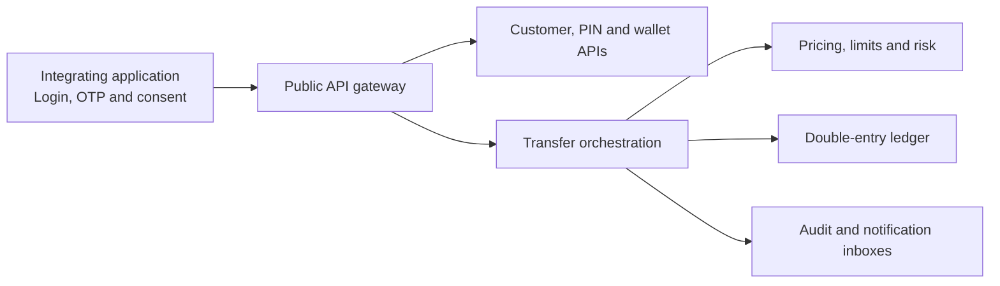

<p align="center">
  
</p>

# BOODOO — Core Mobile Money Platform

**BOODOO** is an open-source backend platform for applications that need digital wallets, secure money transfers and reliable financial accounting.

It provides the core financial APIs behind a Mobile Money ecosystem. Integrating applications own their user experience, login, consent and OTP verification; BOODOO manages customer records, transaction PINs, wallet eligibility and financial workflows.

**Status: active development.** The features below describe the current `main` branch. Additional pilot capabilities are being developed in separate feature branches.

## What BOODOO provides

| Capability | Available on main |
| --- | --- |
| Customer onboarding | Tenant-scoped customer creation, profile completion, directory lookup and profile history. |
| KYC | Evidence submission, independent operator review, dossier history and current approval checks. |
| Transaction PINs | PIN creation, verification, configuration status, persisted attempt counters and lockouts. |
| Digital wallets | Pending wallet creation, activation backed by a ledger account and fresh KYC/PIN eligibility checks. |
| P2P transfers | PIN-authorized transfers with fee quotes, risk decisions, outgoing allowance reservations and durable execution. |
| Financial accounting | Immutable accounts, balanced double-entry journals, derived balances and prevention of overdrafts. |
| Recovery | Persisted transfer phases, fenced execution leases and internal APIs for recovering uncertain outcomes. |
| Audit and notifications | Immutable producer-bound audit events, customer inboxes and acknowledgement tracking. |
| Reconciliation | Internal ledger integrity snapshots and immutable consistency reports. |
| API integration | Authenticated public gateway routes with fixed service destinations and bounded requests/responses. |

The initial financial workflows support **XOF integer minor units**. Pricing, outgoing limits and local risk rules require explicit operator configuration.

## Designed for integration

BOODOO exposes APIs for other applications and platforms. A typical onboarding flow is:

1. The integrating application verifies its user and phone ownership through its own authentication and OTP flow.
2. It creates a customer through BOODOO and completes the customer's profile.
3. It creates the transaction PIN through the separate PIN API and submits KYC evidence.
4. An independent authorized operator reviews the KYC dossier.
5. A pending wallet is created and activated after current KYC and PIN checks.
6. The application initiates transfers and follows their status using the returned resource IDs.

Creating a customer starts KYC in `PENDING`. Customer creation does not send an OTP, create a PIN, approve KYC or activate a wallet.

## Architecture



Each stateful service owns its PostgreSQL database and Flyway migrations. Services communicate through authenticated HTTP APIs. The gateway exposes supported `/v1` routes; internal financial and operator endpoints require direct, protected service access.

| Service | Responsibility | Default local API port |
| --- | --- | ---: |
| [api-gateway](services/api-gateway/README.md) | Public API routing, request boundaries and configured CORS origins. | 8080 |
| [wallet-service](services/wallet-service/README.md) | Wallet creation, activation and operational eligibility. | 8081 |
| [transfer-service](services/transfer-service/README.md) | Durable P2P transfer orchestration and recovery APIs. | 8082 |
| [ledger-service](services/ledger-service/README.md) | Accounts, balanced journals, balances and integrity checks. | 8083 |
| [customer-service](services/customer-service/README.md) | Customer profiles, ownership and KYC. | 8084 |
| [identity-service](services/identity-service/README.md) | Transaction PIN protection and verification. | 8086 |
| [notification-service](services/notification-service/README.md) | Customer inboxes and acknowledgements. | 8087 |
| [pricing-service](services/pricing-service/README.md) | Immutable expiring fee quotes. | 8088 |
| [limits-service](services/limits-service/README.md) | Outgoing allowance reservations and settlement. | 8089 |
| [risk-compliance-service](services/risk-compliance-service/README.md) | Configured local risk assessments. | 8090 |
| [reconciliation-service](services/reconciliation-service/README.md) | Ledger integrity reports. | 8091 |
| [audit-service](services/audit-service/README.md) | Immutable producer-bound audit records. | 8092 |

`distribution-service` and `support-service` are prepared service scaffolds on `main`. Their planned roles are distribution/cash operations and operational support respectively.

## Run locally

Requirements: **Java 25 or later**, Docker and a trusted JWT issuer. Each service is an independent Maven project; the Maven wrapper downloads Maven and dependencies when needed.

For example, start Customer Service and its PostgreSQL 17 database:

```sh
cd services/customer-service

export CUSTOMER_DB_PASSWORD='replace-with-a-local-database-password'
export CUSTOMER_JWT_ISSUER_URI='https://your-issuer.example'
export CUSTOMER_JWT_JWK_SET_URI='https://your-issuer.example/jwks'

docker compose up -d --wait
./mvnw spring-boot:run
```

In another terminal:

```sh
curl --fail http://127.0.0.1:8084/actuator/health
```

Replace the issuer examples with a trusted authorization server. Follow each service's README for its database, dependency URLs, signing-key settings and business policy configuration. The gateway and the complete financial flow require the corresponding services to be running and connected.

### Create a customer

With a trusted bearer token containing the Customer API audience, a signed `integrator_id` and `customers:write`:

```sh
curl --request POST 'http://127.0.0.1:8084/v1/customers' \
  --header "Authorization: Bearer ${BOODOO_ACCESS_TOKEN}" \
  --header 'Content-Type: application/json' \
  --header 'Idempotency-Key: customer-example-001' \
  --data '{
    "externalReference": "example-001",
    "firstName": "Test",
    "lastName": "Example",
    "phoneNumber": "+22370000001"
  }'
```

Through a configured gateway, use `http://127.0.0.1:8080/v1/customers` and a token with both gateway and Customer API audiences. Tenant and actor authority come from signed claims, never from request-body fields or tenant headers.

## Financial integrity and retries

- Transfers use transaction PIN verification, current wallet eligibility, fee quotes, risk assessments and outgoing allowance reservations.
- Journals are balanced and immutable; balances derive from their entries.
- Idempotency keys bind retries to the original tenant, caller and financial intent.
- Persisted execution phases and fenced leases support recovery without treating a lost response as proof of failure.
- A transfer returning `202` remains pending or uncertain. Preserve its ID and idempotency key, then read its status or retry the same intent. A timeout or a journal lookup returning `404` alone does not prove that no money was posted.

## Tests and API documentation

Run a service's PostgreSQL-backed verification suite from its directory:

```sh
./mvnw clean verify
```

Tests use Testcontainers and ephemeral signing keys to exercise tenant isolation, authentication, idempotency, concurrency and financial invariants.

Each service's README documents its setup and permissions. Its `openapi.yaml`, where available, describes request and response contracts. Start with the [public gateway contract](services/api-gateway/openapi.yaml) and the [Customer API contract](services/customer-service/openapi.yaml).

## Pilot work in progress

Feature branches extend the current foundation with merchant payments, controlled cash deposits/withdrawals, wallet freeze/closure, KYC renewal/revocation, linked reversals, authoritative cancellation, automated recovery, signed webhooks and external statement reconciliation. These capabilities should be considered available on `main` after their respective changes are merged.

Real-money operation requires approved tariffs, limits and risk policies, provisioned issuer grants, validated external settlement evidence and coordinated cash correction procedures. Local risk rules and recorded KYC decisions do not replace external verification or operational/regulatory review.

## Technology

Java 25, Spring Boot 4.1.2, Spring Security JWT resource servers, PostgreSQL 17, JDBC, Flyway, Maven Wrapper, JUnit, Testcontainers and Docker Compose.

## License

[Apache License 2.0](LICENSE).
